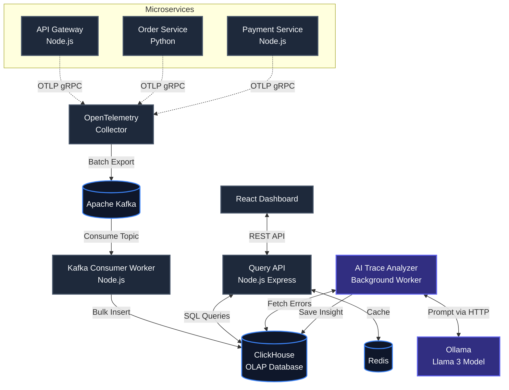

# Observability Platform Architecture & Codebase Overview

This project is a complete, production-ready distributed tracing and observability platform built entirely with free, open-source, and locally-hosted tools. It ingest telemetry data, stores it efficiently, and uses a local AI model (Llama 3) to automatically diagnose errors.

Here is a breakdown of exactly what is happening in the codebase and how data flows through the system.

## Data Flow Diagram

## The 5 Major Layers of the Codebase

### 1. Telemetry Generation (`services/`)
We have three dummy microservices (`api-gateway`, `order-service`, `payment-service`) that simulate a real e-commerce backend.
*   **What they do:** They talk to each other to handle requests, occasionally injecting artificial delays or throwing errors to simulate real-world problems.
*   **How they work:** Before the actual application code boots, a file called `tracing.js` runs. This utilizes the **OpenTelemetry (OTel) SDK** to automatically wrap HTTP calls, database queries, and internal functions in "Spans". These spans measure how long operations take and capture metadata (like status codes).
*   **Output:** They stream these spans and metrics out via the OTLP protocol.

### 2. Ingestion Pipeline (`collector/` & `kafka-consumer/`)
*   **OTel Collector:** Runs in a Docker container and acts as the "front door" for all telemetry data. It receives spans from the microservices, batches them, and pushes them into **Apache Kafka**.
*   **Kafka:** Acts as a massive shock absorber. If a million requests come in at once, Kafka holds the data securely in topics (`otel.traces`, `otel.metrics`) so the database doesn't crash.
*   **Kafka Consumer:** A custom Node.js script that continuously pulls batches of messages out of Kafka, flattens the nested data structures, and does high-speed bulk inserts into the database.

### 3. Storage (`infra/clickhouse/`)
*   **ClickHouse:** This is a blazing fast columnar OLAP database, heavily favored in modern observability (used by companies like Uber and Cloudflare).
*   **Materialized Views:** Instead of calculating the "p99 latency" for a service every time the user loads the dashboard (which is slow), ClickHouse uses a Materialized View (`service_latency_mv`). As new traces are inserted, ClickHouse automatically pre-aggregates the latencies and error counts minute-by-minute in the background.

### 4. Query API & Local AI (`query-api/` & `ollama`)
*   **Query API:** A Node.js backend that serves data to the frontend. It runs SQL queries against ClickHouse to fetch trace waterfalls and metric aggregations. It caches heavy queries (like the full service dependency graph) in **Redis**.
*   **AI Trace Analyzer:** A background worker running inside the API service. Every 60 seconds, it asks ClickHouse: *"Show me any traces that resulted in an HTTP 500 error in the last minute."*
*   **Ollama (Llama 3):** When the analyzer finds an errored trace, it packages all the spans into a text prompt and sends it to a local Llama 3 instance running in Docker via **Ollama**. The LLM reads the spans, deduces the root cause (e.g., *"Payment-service timed out calling an external gateway"*), and spits out a JSON response with a severity rating and recommendation. This is saved back into ClickHouse.

### 5. Frontend Dashboard (`dashboard/`)
The React application we just finished updating. It provides three main views:
*   **Service Graph:** Fetches nodes/edges from the API and uses React Flow (with Dagre auto-layout) to draw a live architectural map. Edges turn red if latency spikes.
*   **Metrics View:** Shows live Recharts graphs mapping latency percentiles and error rates. It also pulls a feed of active anomalies.
*   **Trace Explorer:** A powerful search table to find individual requests. Clicking one reveals a cascading waterfall graph showing exactly how much time was spent in each service, alongside the AI-generated root cause analysis side-panel.

---

> [!TIP]
> **Why this architecture is powerful:** This completely mimics the architecture of expensive enterprise SaaS products like Datadog or Honeycomb. Using Kafka for backpressure and ClickHouse for columnar storage means this setup could realistically handle thousands of spans per second on standard hardware.
